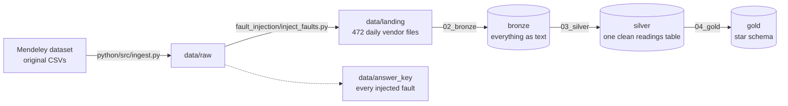

# SOLAR: a tested medallion pipeline on real solar plant data

[](https://github.com/pnzavitsanos/solar-medallion/actions/workflows/ci.yml)


Raw telemetry from **7 solar plants** and **two inverter vendors** (Huawei FusionSolar and Solis) goes through a
**bronze → silver → gold** medallion pipeline and comes out as a tested star schema.

The original public dataset is fairly clean, so I **deliberately broke it** first: duplicated files, decimal commas,
mixed date formats, watts sent as kilowatts, sensor overflows, made-up device ids, missing hours. Every injected
fault is logged in an answer key, so the silver layer can be checked against known truth.

Everything is reproducible: the corrupted data is published as a release, and CI rebuilds the whole pipeline
from it and runs the tests on every change.

| | |
|---|---|
| Readings in silver | 1,180,215 (5-minute intervals) |
| Valid after quality rules | 1,177,533 (99.77%) |
| Plants / devices | 7 / 66 (53 inverters) |
| Period | 27 June 2024 – 1 June 2025 |
| Daily energy rows (gold) | 8,248 inverter-days |

---

## Architecture



| Layer | Notebook | What happens |
|---|---|---|
| Landing | `fault_injection/inject_faults.py` | Splits the vendor files into daily exports and injects faults (fixed seed, so the same faults every run). |
| Bronze | `python/notebooks/02_bronze.ipynb` | Loads every daily file as-is, all columns as text, plus landing checks in `reports/`. |
| Silver | `python/notebooks/03_silver.ipynb` | Same column names for both vendors, real types, all times in UTC, clean device ids, duplicates removed (latest file wins), impossible values flagged, one common ON/OFF/ERROR state. |
| Gold | `python/notebooks/04_gold.ipynb` | Star schema: `fact_readings`, `fact_daily_energy`, and `dim_date`, `dim_device`, `dim_station`, `dim_state`. |

The silver cleaning rules live in [`python/src/silver_rules.py`](python/src/silver_rules.py), so the notebook and the unit tests use the same code.

---

## Reproduce it

You need Python 3.14 and Git. Commands are for Windows PowerShell. On macOS/Linux use `source .venv/bin/activate` and `unzip`.

**1. Clone and install**
```powershell
git clone https://github.com/pnzavitsanos/solar-medallion.git
cd solar-medallion
python -m venv .venv
.venv\Scripts\Activate.ps1
pip install -r python/requirements-dev.txt
```

**2. Get the corrupted landing data.** Download `landing-data-v1.0.zip` and `SHA256SUMS.txt` from the
[data-v1.0 release](https://github.com/pnzavitsanos/solar-medallion/releases/tag/data-v1.0) into the repo folder, then:
```powershell
Get-FileHash landing-data-v1.0.zip -Algorithm SHA256   # must match SHA256SUMS.txt
Expand-Archive landing-data-v1.0.zip -DestinationPath .
```
This creates `data/landing/`. (`data/` is ignored by Git.)

**3. Build bronze, silver and gold**
```powershell
cd python/notebooks
foreach ($nb in "02_bronze", "03_silver", "04_gold") { jupyter nbconvert --to notebook --execute --inplace "$nb.ipynb" }
cd ../..
```
Or open the notebooks in VS Code / Jupyter and use **Run All**, in that order.

**4. Run the tests**
```powershell
pytest -v
```
Expected: **13 passed**.

<details>
<summary>Rebuild the landing data from the original dataset instead</summary>

```powershell
python python/src/ingest.py                 # downloads the original CSVs into data/raw
python fault_injection/inject_faults.py     # writes data/landing and data/answer_key
```
The seed is fixed, so this produces the same landing files as the release.
</details>

---

## Tests and CI

| File | Needs data? | Checks |
|---|---|---|
| `python/tests/test_silver_rules.py` | no | Each cleaning rule on a tiny hand-made table, one row per fault: decimal commas and `NULL` markers, device id clean-up, "latest file wins" for re-sent readings, and the four impossible-value flags. |
| `python/tests/test_repo.py` | no | `data/` and `.venv/` stay out of Git, and every package is pinned to an exact version. |
| `python/tests/test_gold.py` | yes | All gold tables exist, daily energy is never negative and never above the physical limit (55 kW × 24 h), one row per device per day, no orphan stations, and a known regression value (SOLIS Station 1, May 2025 = 271,033 kWh). |

[GitHub Actions](.github/workflows/ci.yml) runs on every pull request, on every push to `main`, and on demand
(**Actions → CI → Run workflow**). It downloads the release, verifies the checksum, executes bronze → silver → gold
on a clean Linux machine, and runs all 13 tests.

---

## Data quality

Faults that can't be fixed safely are **flagged, never deleted**:

| Flag | Rule | FusionSolar | Solis |
|---|---|---:|---:|
| `unknown_device` | device id not in the device register | 276 | 0 |
| `bad_temperature` | inverter temperature above 100 °C | 136 | 120 |
| `bad_counter` | lifetime energy counter reads 0 | 199 | 139 |
| `unknown_state` | state code not in the vendor's mapping | 335 | 226 |
| `too_much_power` | AC power above 2 × rated power (watts sent as kW) | 1,249 | 13 |
| `bad_energy_today` | daily energy above 24 h × rated power | 1 | 19 |

Some flags also catch problems that were already in the original data (for example 29 Solis temperature overflows like 3276.7 °C).

---

## Answer key (spoilers)

[`answer-key-v1.0.zip`](https://github.com/pnzavitsanos/solar-medallion/releases/tag/data-v1.0) lists every injected
fault row by row, and [`fault_injection/README.md`](fault_injection/README.md) describes each fault type.
If you want to find the faults yourself first, skip both.

---

## Repository layout

```
.
├── .github/workflows/ci.yml   CI: download release → build pipeline → pytest
├── fault_injection/           turns the clean dataset into messy daily vendor exports
├── python/
│   ├── notebooks/             01 explore, 02 bronze, 03 silver, 04 gold
│   ├── src/                   ingest.py (download), silver_rules.py (cleaning rules)
│   ├── tests/                 pytest suite
│   ├── requirements.txt       pinned runtime packages
│   └── requirements-dev.txt   + pytest, nbconvert
├── reports/                   landing checks written by the bronze notebook
└── pytest.ini
```

---

## Roadmap

- [ ] Rebuild the same pipeline in **Microsoft Fabric** (Lakehouse, Spark, Warehouse, Power BI) and sync it into `fabric/` with Fabric Git integration.
- [ ] Score silver against the answer key: catch rate per fault type.
- [ ] Unit tests for the gold transformations.

---

## Data source and licence

The original data is **"Dataset for unified photovoltaic-weather multi-station analysis in North Macedonia"** (version 2)
by Andrej Daskalov and Eftim Zdravevski, Mendeley Data, DOI [10.17632/4zgsckxpdy.2](https://doi.org/10.17632/4zgsckxpdy.2),
licensed [CC BY 4.0](https://creativecommons.org/licenses/by/4.0/). It is described in Daskalov et al., *SolarMagix*, Data in Brief 67 (2026) 112830.

The data in this repository's release is a **modified** version: faults were injected on purpose by `fault_injection/inject_faults.py`.
The original authors do not endorse this version.


